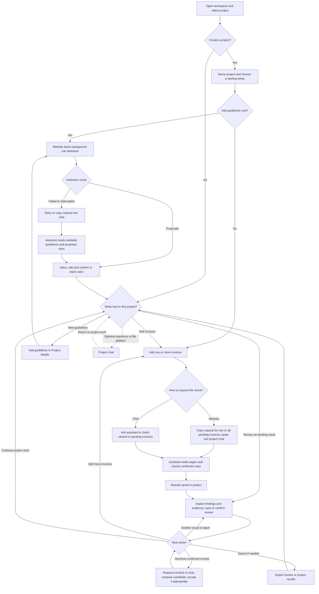
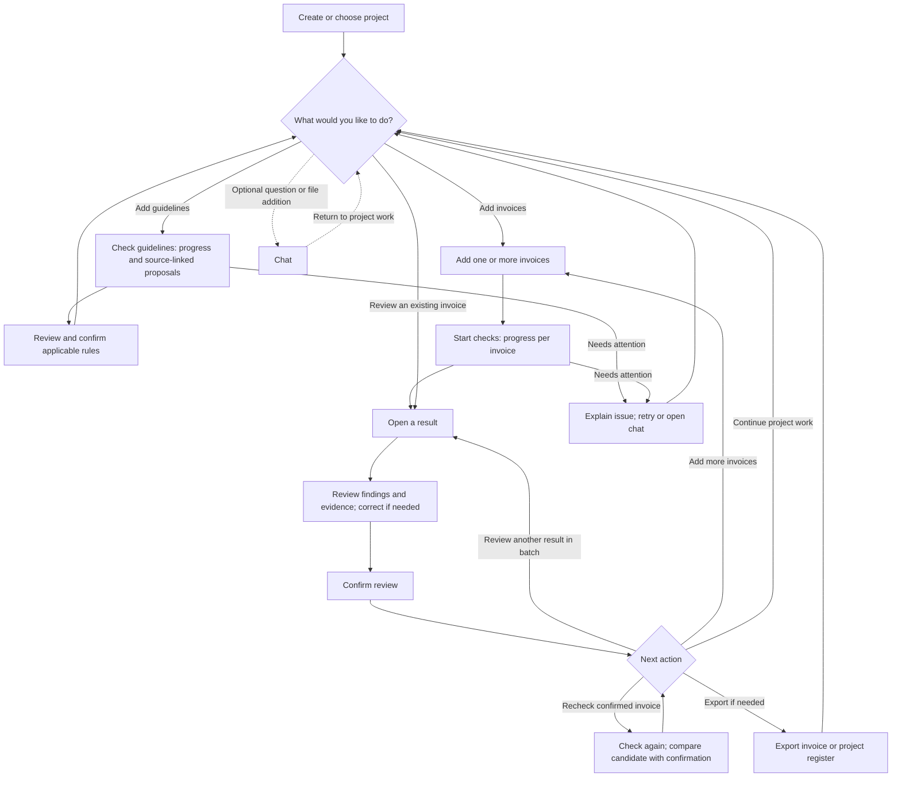

# Workflow audit

This audit describes the current local workspace and a proposed simpler workflow. It is based on the application, tools and assistant skills in this checkout. The proposal needs a staff pilot before it becomes an implementation specification.

## Assessment

The workflow feels complicated because reviewers must understand which of two AI paths to use, move between a website and a chat for routine invoice checks, and make setup decisions before they have seen a result. The website starts a background Codex run for guidelines, yet checking an invoice requires copying a request and pasting it into a separate chat. Both interactions are described as “ask the assistant,” but they behave differently. A reviewer must also distinguish proposed rules, confirmed rules, saved drafts, confirmed reviews and pending rechecks. Those distinctions protect decisions, but the interface exposes too many of them at once.

The roles already implied by the product are sound. Staff review evidence and approve changes in the workspace. The assistant reads source material and answers questions. The most important simplification is to make the workspace the place where staff start and track routine work, with chat available for questions, exceptions and guided help.

## What happens today

Chat can also initiate checks directly without a copied request. Invoices and guidelines can be added through chat using the add-files skill. Existing projects without a previous detection run have a **Check rules from guidelines** action. The Inbox is hidden when no items are pending. The website currently has four starting setup choices, six Project setup subsections when Inbox is present, and three Settings subsections. [New project and navigation](../app/index.html), [guideline status and Inbox](../app/project-setup.js), [check-invoices skill](../skills/check-invoices/SKILL.md), [add-files skill](../skills/add-files/SKILL.md)

### Boundaries and failure states

- **Guidelines through the website** start a separate background Codex CLI run using the signed-in Codex plan. The server extracts readable PDF, text or Markdown content, sends it to Codex, validates source filenames and page numbers, and saves proposed rules. This is a separate run, not a message in the current chat. Proposed rules start as visual checks and need review. A scanned page without readable text, an oversized input, sign-in failure, interrupted server or timeout leads to failure and retry or a chat request. The current chat proposal skill also says it cannot read scanned guidelines, so a scanned PDF needs a readable text version or a future OCR workflow. Detection continues when the dialog closes while the server stays running. [Detection implementation](../tools/detect_rules.py), [website detection state](../app/workspace.js)
- **Proposal paths differ.** Website detection creates visual checks with error severity and deduplicates by type and normalized name. The chat skill can propose visual or structured checks and tells the assistant to skip confirmed rules. Similar pending proposals can therefore recur or differ across the two routes. Source/page validation checks that the citation exists, while staff must still verify that the text supports the rule. A shared proposal contract, comparison against pending and confirmed rules, and a clear duplicate-review flow would reduce divergence. [Automatic detection](../tools/detect_rules.py), [chat proposal skill](../skills/propose-rules/SKILL.md)
- **Invoice checking today** is initiated in a project chat. The website copies a project- and invoice-specific request, but does not submit it to that chat. The assistant reads all pages, classifies the invoice, extracts fields, marks located evidence and saves a result using the pinned project. Only confirmed rules apply. An invoice with no applicable rules is explicitly labelled. [Invoice request and review](../app/invoice-review.js), [check-invoices skill](../skills/check-invoices/SKILL.md)
- **Review** is a human decision. Staff can correct values, change outcomes with explanations, adjust marks, save or confirm. A recheck of a confirmed invoice is staged until staff accept it. Existing confirmed results remain the basis for exports in the meantime. [Review persistence](../tools/results.py), [recheck interface](../app/invoice-review.js)
- **Sharing** has distinct outputs. The project workbook supports reporting, the invoice PDF/CSV/text shares a result, the setup JSON creates a new project, and a rules ZIP imports confirmed rules into a compatible project's Inbox. The ZIP import requires matching type and field IDs and adds new proposals rather than synchronizing later edits between projects. [Export interface](../app/workspace-exports.js), [share-rules skill](../skills/share-rules/SKILL.md)
- **Privacy and account clarity** need correction in the guide. It says the page never calls AI and the assistant must never send data outside the computer, while automatic detection actually sends guideline text to Codex through the signed-in account. Clearly describe that transfer and the separate invoice-chat processing before use. [Current guide](../README.md), [assistant instructions](../AGENTS.md), [detection implementation](../tools/detect_rules.py)

## Where people must stop and interpret the system

| Friction | Why it matters | Proposed simplification |
| --- | --- | --- |
| Four starting setups plus optional guidelines | A new reviewer must understand templates, existing projects and imports before creating a project. | Default to a named project with standard fields and optional guidelines. Put template, copy and import under **More starting options**. Preserve the AEXCID template for teams who need it. |
| Different mechanisms for guidelines and invoices | Guidelines trigger Codex automatically, invoices require a copy/paste handoff. A user cannot predict what **Check** does. | Use the same visible job pattern for both: **Check guidelines** or **Check invoices**, progress, results, retry. Until invoice automation exists, label the button **Copy request for chat** and explain the paste step. |
| Detection status, Inbox, rules and check methods | Staff must navigate from a status to an Inbox, understand proposals, inspect source text, and edit check configuration. | Show a single **Review proposed rules** destination from the project overview with source, applicability and confirm/reject. Move technical check method and field mapping into an expandable advanced editor. Keep review before rules apply. |
| No confirmed rules | A check can finish with no applicable rules and still generate extracted values. | Before starting an invoice check, show a compact readiness message if its type or applicable rules are unknown. At result time keep **No applicable rules** prominent and offer **Review rules**. Do not prohibit extraction where staff choose to continue. |
| Multiple review states and actions | Draft, confirmed and staged recheck describe meaningful different data, but can compete for attention. | Give each invoice one clear next action: **Review**, **Continue review**, or **Compare recheck**. Show the previous confirmed decision when a recheck is pending and make accepting it explicit. |
| Exports spread between invoice and Settings | The same formats appear in two locations and their scopes vary. | Keep invoice Export in the invoice and project Export in Settings. Name each output by scope and content. Provide one visible register-row action for the actual staff template once validated. |
| Two paths to add files and request rules | Website uploads trigger detection; chat additions only continue to propose when asked. Multiple entry points are useful, but their effects are not obvious. | Support both. After adding in chat, ask or act according to the request and report where to review results. In the workspace show a consistent next action and job status regardless of where files arrived. |
| Error and completion feedback scattered | Failure, retry, Inbox visibility and unread status may require returning to Project setup. | Put project-scoped progress and completion on an overview and preserve failure details, retry and draft state. Avoid running a second job merely because a person revisits the page. |

## Proposed simpler flow

**Proposal, not implemented.** A primary invoice-check action on the website would require a new job runner and careful review of permissions, account behavior and cost. The existing Codex guideline runner proves a separate background process is possible in this environment, but it does not establish that the same mechanism correctly performs the full page-reading and evidence-marking workflow for every supported assistant.

### Website and chat

| Job | Recommended main place | Chat use |
| --- | --- | --- |
| Start and monitor rule detection | Website, immediately after guideline upload, with a visible progress/result state | Ask for a deeper interpretation, request proposals manually, or add guideline files by name. |
| Add and check invoices | Website, with one check action and status per invoice | Add files or request a check directly in chat. Ask about a specific invoice or a finding. |
| Approve a rule or invoice result | Website, next to the source and evidence | Explain an uncertainty or propose a change. The human makes the approval in the workspace. |
| Correct a value or teach a reusable instruction | Website, with a clear choice between this invoice and future invoices | Ask why a value was read a certain way or request a proposed improvement. |
| Transfer a setup or share results | Website exports with labels for invoice, project and rules | Import a supplied rules ZIP into the chosen project and explain any missing matching types or fields. |

A concrete journey would be: create “Project A,” add the funder guidelines, watch the rule check complete, review and confirm the proposed rules, add a batch of invoices, start their checks, open an invoice marked **Needs review**, inspect a highlighted source, correct an amount and confirm. Staff can review the next invoice, add another batch, recheck a confirmed invoice, or export when needed. Later guideline additions return to rule review without creating another project. A reviewer opens chat when they need an explanation or prefer to supply files there. The same project identity must travel with every job and result.

## Implementation order and tradeoffs

1. **Clarify the current flow without changing its execution.** Use a project overview with one next action and explain the existing chat handoff on invoice checks. Make job progress, errors and **Review proposed rules** visible after returning. Correct the guide’s account/data descriptions and test with a new user. This can be done without assuming chat submission exists.
2. **Reduce setup choices and separate routine review from advanced configuration.** Default to standard fields, reveal template/copy/import on request, show source-linked rule decisions with advanced check details expandable. Pilot with a new project and an existing AEXCID project, including cases with no confirmed rules.
3. **Build a unified job model.** Track queued, running, needs attention, completed and interrupted jobs by project and invoice, with retry and clear concurrency behavior. Preserve confirmed results during rechecks and preserve unsaved edits while job results arrive. A worker must not silently use an account or settings different from what the person selected.
4. **Only then add website-started invoice checks.** Prove the worker can inspect pages and mark evidence, runs with the user's selected assistant and permissions, handles failed or interrupted checks, and leaves a reviewable result. Include explicit account/plan use and avoid assuming a website can submit into an existing chat.
5. **Pilot the handoffs and exports.** Observe a staff member checking one ordinary invoice, entering it into their real register and giving a marked PDF to a partner. Use their register template to choose the columns and ordering. Try scanned guidelines with a readable replacement or future OCR, a multipage bundle, two projects and a failed job.

The future design system proposal contains component-level detail. [Design proposal](design-system/README.md)
